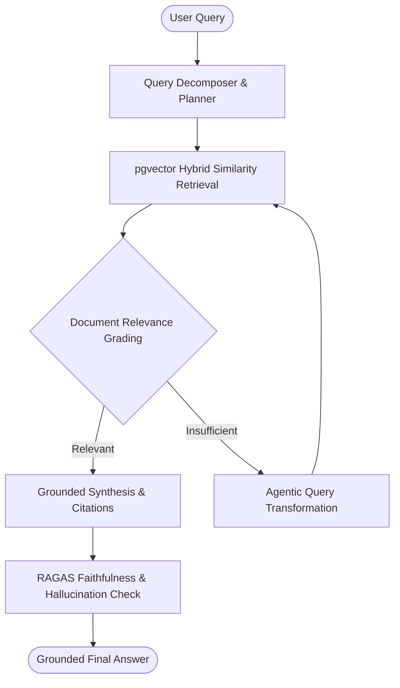

# 🧠 Enterprise Agentic RAG

[](https://github.com/MSBHOSLE/enterprise-agentic-rag/actions)
[](https://langchain.com/)
[](https://github.com/pgvector/pgvector)
[](https://python.org)
[](https://docker.com)
[](LICENSE)

A production-grade **Enterprise Agentic Retrieval-Augmented Generation (RAG)** platform. Utilizes **LangGraph** for autonomous routing, query rewriting, and self-reflective document grading with **pgvector** similarity retrieval and **RAGAS** hallucination/faithfulness evaluation metrics.

---

## 🏗️ Agentic Graph Workflow



---

## ⚡ Highlights

- **Reflective Document Grading**: Eliminates hallucination by actively grading chunk relevance before synthesis.
- **RAGAS Quality Gate**: Automated evaluation scoring Faithfulness, Answer Relevance, and Context Precision.
- **Hybrid Retrieval**: Combines semantic embeddings with dense vector index lookups.

---

## 🚀 Running Tests

```bash
python -m unittest discover tests
```

---

## 👤 Author

**Mahesh Sanjayrao Bhosle**
- **GitHub:** [@MSBHOSLE](https://github.com/MSBHOSLE)
- **LinkedIn:** [Mahesh Bhosle](https://linkedin.com/in/mahesh-bhosle-916991198)
- **Email:** msbhosle.2@gmail.com
- **Education:** M.Sc. Data & Computer Science, Heidelberg University

---

## 📄 License

MIT License - see [LICENSE](LICENSE).
